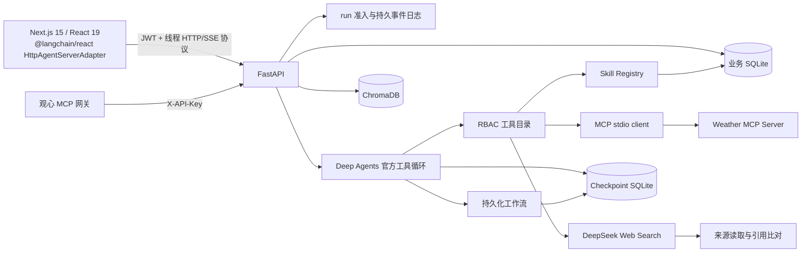
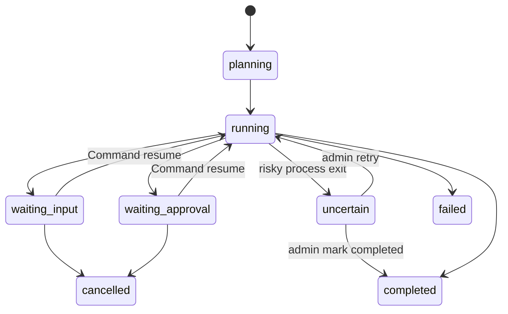

# 观心 v2 当前架构

> 版本：v3.0-langchain-native
>
> 日期：2026-11-09
> 状态：Implemented
>
> 2026-11 更正：原 v2.2-supervisor-research 版本描述的 Supervisor 决策节点、Tool Loop 与 `/api/agent/chat/aisdk` 协议已随 LangChain 原生迁移删除。§1、§3、§4、§6 已按现行代码重写，决策记录见 `docs/superpowers/specs/2026-09-07-langchain-native-design.md`。

## 1. 运行时结构

前端统一运行在 3000 端口，通过 Next.js rewrite 把 `/api/*` 代理到 8000 端口后端。Assistant 只使用官方适配器所需的 `/api/agent/threads/*` 协议端点；AI SDK 端点与前端依赖已移除，本仓库不再自研前端 Agent 状态机。

## 2. 数据职责

| 存储 | 数据 | 隔离方式 |
|---|---|---|
| SQLite | documents、document_chunks、conversations、conversation_messages、agent_configs、agent_runs、agent_events、tool_approvals、workflow_runs、workflow_steps、workflow_interrupts、workflow_step_executions、mcp_tool_policies、research_runs、research_tasks、research_sources、research_events、research_ledgers、citation_evidence、citation_claims、schema_version | tenant_id；会话、工作流与研究再校验 user_id |
| Checkpoint SQLite | Assistant 线程游标（`agent:{conversation_id}`）与工作流执行游标 / interrupt 状态（`run_id`） | 线程 id 由服务端生成；恢复前先做业务归属校验 |
| ChromaDB | 文档向量 | 每租户独立 collection `tenant-{tenant_id}-kb` |
| users.json | 预设用户和 API Key | UserManager 校验 tenant_id |
| uploads | 原始上传文件 | SQLite 文档记录关联唯一 doc_id 路径 |

SQLite 每次操作创建独立连接，启用 WAL、foreign keys、5 秒 busy timeout；写事务使用 `BEGIN IMMEDIATE`，避免并发写锁升级失败。Schema 初始化版本化且幂等（当前 `SCHEMA_VERSION = 5`）。

## 3. Assistant 链路

1. 前端用官方 `HttpAgentServerAdapter` + `useStream` 订阅线程；`conversation_id` 在服务端创建，客户端不能自行指定 tenant、user、model 或工具权限。
2. `POST /threads/{id}/commands` 只接受 `run.start`，且输入必须是一条 human 文本（≤100000 字符）加可选 `research_mode`（auto / quick / deep）；其他命令明确返回 `not_supported`。
3. 后端验证 JWT / API Key 后按 tenant_id + user_id 校验会话，越权统一 404。`conversation_id` 即 LangGraph 线程 `agent:{conversation_id}`。
4. run 准入是持久化判重的：`(conversation_id, request_key)` 唯一，同一会话由部分唯一索引保证至多一个 `running` run；重复提交返回同一 run。
5. `build_deep_agent` 按租户 Agent 配置和 RBAC 构造工具目录，交给 Deep Agents 官方工具循环；`AuthorizedToolsMiddleware` 每次工具调用前重新构造目录复核授权，并永久禁用 `task`（子代理）与 `execute`（宿主 shell）。
6. 运行在后台任务中进行，原生 v3 事件只做 envelope 适配（messages 的 tuple → data/node）、持久化序号与业务投影，随后写入 `agent_events` 供 `POST /threads/{id}/stream/events` 断线重放。关闭浏览器只结束订阅，不取消任务；显式 cancel 才停止。
7. 每次运行上限：模型 16 次、工具 24 次、480 秒。服务重启把遗留 `running` 标为 `interrupted`，不自动重放。
8. 写操作不进入通用 Agent：需要修改业务数据时调用 `request_business_workflow` 建立审批工作流后结束回复。

DeepSeek V4 通过 OpenAI 兼容接口驱动 Deep Agents；Chat Completions 侧不保存或展示原始思维链。Checkpoint 是唯一执行状态，`conversation_messages` 只是兼容历史与导出的投影。

## 4. 联网研究

研究能力由三个只读工具加会话级账本组成，不存在独立的 planner / gap-analyzer / synthesizer 图：

- `web_search`：调用 DeepSeek Responses API 内置 Web Search，返回带来源的回答与动作计数。
- `read_source`：只读取本会话搜索结果中出现过、且域名在 `RESEARCH_SOURCE_HOSTS` 白名单内的 HTTPS 页面，正文上限 1 MB、总读取期限 25 秒，拒绝私网地址与带凭据 / 非标准端口的 URL。
- `record_citation`：把主张与原文逐字摘录（或 `read_source` 返回的 `passage_id`）绑定，只有当摘录确实存在于已获取正文时才成功。

预算按会话累计且不因取消、继续、重启或切换模式而重置：auto / quick 最多 2 次搜索请求、20 个服务端动作，deep 最多 4 次请求、40 个动作。搜索串行准入，上次用量未知时暂停后续搜索。动作阈值只能阻止后续请求，无法截断供应商当前请求内部的动作，因此不是费用上限。

网页内容始终是不可信证据：文字匹配只说明摘录存在，不推出主张成立，所有条目保持待人工审查。旧的 `research_runs` 记录只保留历史读取、取消与转入原生任务，旧报告作为不可信上下文重新核实。

## 5. 持久化工作流

DeepSeek Planner 只获得当前租户 Agent 已启用并经 RBAC 过滤的工具定义，生成最多 16 步的线性计划。服务端校验工具、参数及 `$inputs.*` / `$steps.*` 引用；失败时只允许模型修复一次。计划通过后写入业务 SQLite，再由 LangGraph 逐步执行。

只读工具失败自动重试一次；写操作和 MCP 不自动重试。每次调用前先写 `executing` 和幂等键，重复恢复直接返回已保存结果。若进程在风险工具窗口退出，启动恢复只会将流程置为 `uncertain`，不会自动重放。

每个会话由部分唯一索引保证至多一个活动流程。删除会话会级联清理业务工作流记录，并删除对应 checkpoint thread。

## 6. 审批与中断

新工作流统一使用 `workflow_interrupts`（kind = input / approval / recovery）：前端把表单值或审批结论提交到 `POST /api/agent/workflows/{run_id}/respond`，服务端先在业务表校验 interrupt 归属与工具当前是否仍被授权，再以同一 interrupt 幂等恢复 LangGraph。

`tool_approvals` 只用于展示历史记录，不再承载新请求。历史 approve → consumed 的原子领取语义保留：已批准的 action 只能被领取一次，重复请求无法再次执行。

## 7. RBAC

| 能力 | user | admin |
|---|:---:|:---:|
| 本租户知识库上传/查询/删除 | ✓ | ✓ |
| 文本摘要、数据分析 | ✓ | ✓ |
| 读取 Agent 配置、调用已连接 MCP | ✓ | ✓ |
| 修改 Agent 配置 |  | ✓ |
| MCP 注册/删除/连接 |  | ✓ |
| 用户管理、数据导出、系统诊断 |  | ✓ |

授权同时存在于 API dependency、SkillExecutor 和 Agent 工具注册层。普通用户无法从 Agent 可用工具列表发现管理工具。

工作流在规划、执行和每次恢复前均重新过滤工具与鉴权。跨租户或跨用户查询统一返回 404；权限在等待期间被撤销时，恢复返回 403 且不会调用工具。

## 8. 文档写入一致性

上传顺序为：创建 SQLite 记录 → 保存文件 → 解析/切片 → 写 Chroma → READY。异常统一标记 FAILED，并按 chunk ID 补偿可能已写入的向量。删除前先验证租户；Chroma 删除失败则中止，成功后再删除文件和 SQLite 元数据。文件写入、解析、Embedding 与 Chroma 写入整体放在线程池执行，不阻塞事件循环。

## 9. 工程门槛

- 后端：`pytest -q`（含真实 MCP stdio 协议测试）
- 前端：`npm run lint`、`npx tsc --noEmit`、`npm run build`
- 浏览器黄金路径：`npm run test:e2e`，原生 Agent 用例另跑 `GUANXIN_E2E_AGENT_FIXTURE=1 npm run test:e2e -- e2e/native-agent.spec.ts`
- 本地启动：`./scripts/start.sh`

自动测试 mock LLM/Embedding/MCP，不调用真实付费模型。生产部署、分布式锁、条件分支、并行 DAG、审计日志、限流、远程 MCP SSE 和用户账户 SQLite 迁移不在当前版本范围。
